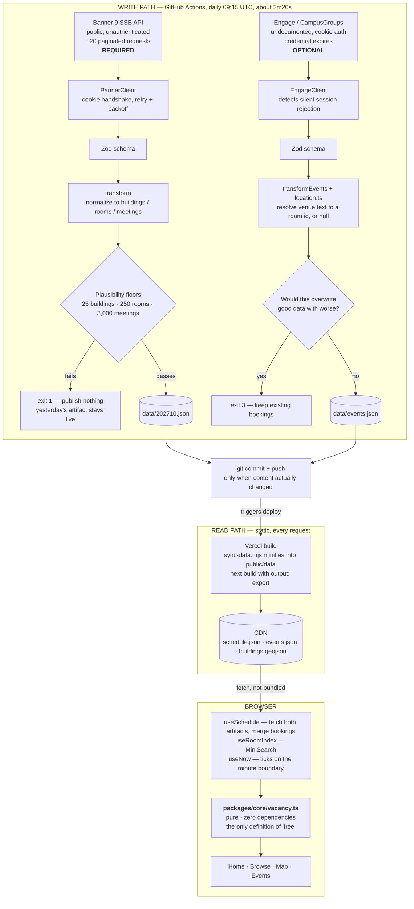
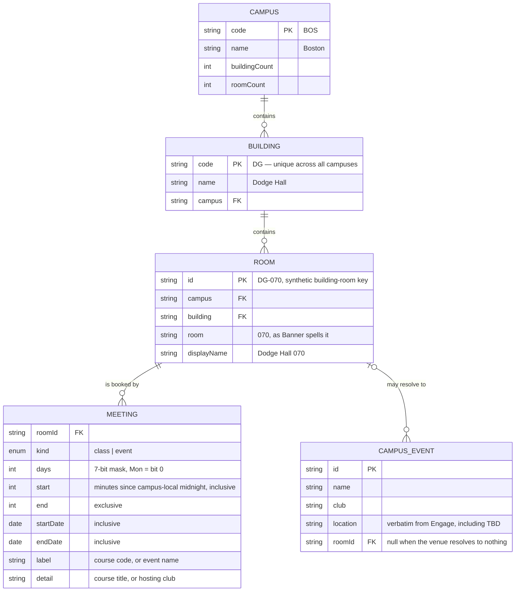
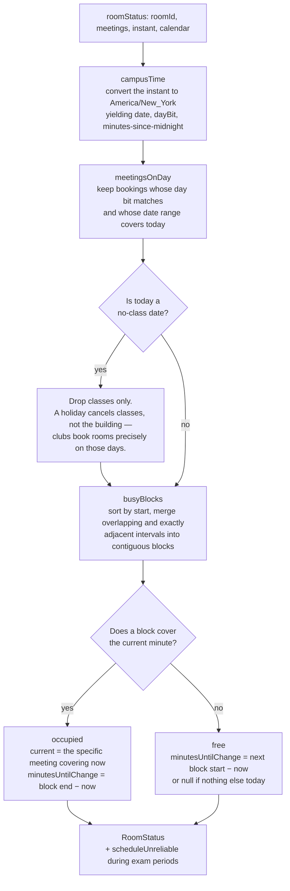
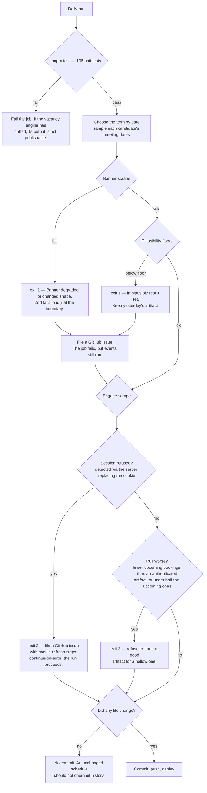
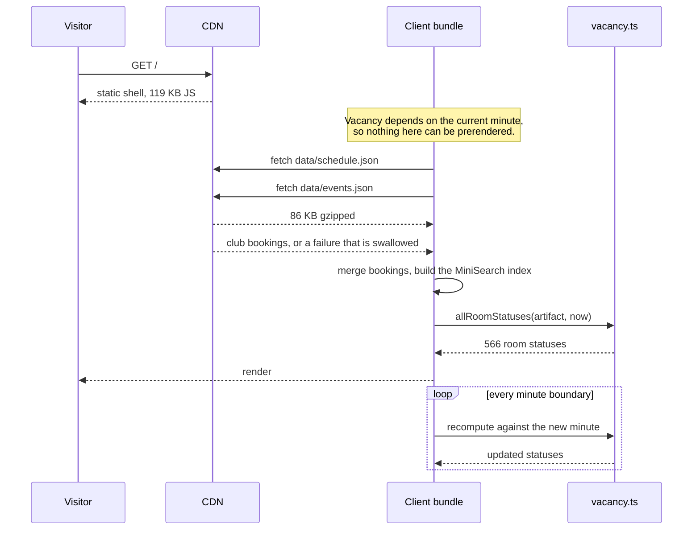

# Architecture

vacantNEU is the inverse of a course catalog. Every registrar system answers "where is my class?";
this one answers "which rooms have nothing in them?" — the same dataset read backwards. A room is
free exactly when no booking covers the current instant.

Every structural decision here follows from one measurement: **a full term of room bookings is
86 KB gzipped and barely changes within the term.** That number is what makes a database
unnecessary, a server unnecessary, and a client-side vacancy engine correct rather than clever.

## The system in one picture

Two halves that share no runtime dependency. The write path produces an artifact once a day; the
read path serves it. If the scraper never ran again, the site would keep working — degrading
slowly as the term drifts, rather than failing.

`vacancy.ts` is also what the `pnpm inspect` CLI and the 106 unit tests run against. One definition
of "free", four consumers: if the map and Browse ever disagree about a room, that is a UI bug, not
a data question.

## Why there is no database

The entire room schedule is 86 KB gzipped and effectively immutable within a term. A database
would add cost, latency, and an ops burden while making the product _worse_ — every "is this room
free?" would become a network round trip for arithmetic the browser can do in microseconds. The
browser downloads the dataset once and answers every subsequent question locally, including
questions asked while offline.

The artifact is nonetheless modeled as normalized tables, so outgrowing it is a loader script
rather than a remodelling exercise.

Two modelling choices carry weight. Classes and club events collapse into one `Meeting` shape,
because a room is occupied if _anything_ is in it — they are distinguished only for display, and
so a failure to reach one source can never be mistaken for the room being free. And times are
stored as minutes since campus-local midnight plus a day bitmask rather than timestamps: compact,
and every comparison the engine makes is integer arithmetic.

## Computing vacancy

Pure, dependency-free, and shared by every surface. The only input beyond the artifact is the
instant being asked about, which is why the page cannot be prerendered.

Only _touching_ intervals merge. A 10-minute passing period between two classes is reported
honestly as 10 free minutes; deciding such a gap is too short to be useful is a UI concern, handled
by the "free for at least N minutes" filter, not a data concern.

The academic calendar is the one input that cannot be scraped. Banner's meeting rows carry a date
range and day flags but know nothing about holidays — a Mon/Wed class dated 09/09–12/20 will
happily claim its room on Thanksgiving. So `packages/core/calendar.ts` is transcribed by hand from
the registrar's PDF and must be reviewed every academic year.

## The failure model

This is the part with the most thought in it, because the failure modes are asymmetric. Stale data
is mildly annoying. **Wrong data sends someone to a room with a lecture already in it** — and the
specific way this pipeline breaks, a truncated or empty upstream response, produces exactly that:
an artifact marking every room on campus free. Every gate below exists to make "publish nothing"
the default outcome of anything unexpected.

### Which term is current

Banner keeps several terms open at once: from early November, Spring is open for registration
and listed above Fall, weeks before its first class and with most of its rooms unassigned. The
scraper originally took the newest open term, so on November 2 it switched to Spring. The floors
then refused the thin result every day, which kept bad data off the site but left it serving
stale data.

The term is now chosen by date. For Banner's three newest main semesters (CPS and Law calendars
excluded, "(View Only)" ignored because it flips on an administrative schedule), one sample page
gives the term's span. The start is the most common meeting start date, and the end is the date by
which 90% of meetings have finished, so finals count and a stray long-running row does not. Then:
the term in session wins. Failing that, a term starting within 7 days. Failing that, the term
that most recently ended, because during a break its schedule correctly shows rooms free. The
rules live in `term.ts` and are tested across a full year of transitions.

### Sources are tiered, not equal partners

Banner is public, unauthenticated, and required. Engage is undocumented, sits behind a credential
that expires on no published schedule, and is optional. That asymmetry is enforced at every layer
— separate artifacts, separate CI steps with `continue-on-error`, separate `fetch` calls in the
browser where the events request ends in `.catch(() => null)`. Getting it backwards would mean an
expired cookie takes down the thing the app is actually for.

### The failure that looks like success

Engage does not reject a stale session. It silently mints a fresh anonymous one, returns 200, and
redacts nearly every venue to `Private Location (sign in to display)`. The scrape appears to
succeed and quietly finds almost nothing — on an anonymous pull roughly 95% of events have no
usable location.

Two defences. The client infers rejection from the server _replacing_ the session cookie, which
only happens when the one sent was refused, and raises `EngageSessionError` for a distinct exit
code. And the writer refuses to overwrite an authenticated artifact with an anonymous pull that
finds fewer bookings, or to accept a pull with under half the previous bookings, so even an
undetected downgrade cannot silently discard weeks of real data.

Both comparisons count only bookings that are still ahead. Events are dated, so an artifact decays
on its own. Counting every booking let a single authenticated pull from early September block every
anonymous pull through November, long after most of its bookings had passed.

The same trap catches humans: the session token contains percent sequences (`%2b`, `%3d`) and
CampusGroups expects them byte-for-byte as the browser stores them. Decoding them first yields a
token the server does not recognise — and does not complain about.

## The read path

The artifacts are fetched rather than imported. That keeps them out of the JS bundle and lets the
CDN revalidate data without a code deploy — a schedule refresh does not require shipping code.

The clock ticks on the minute _boundary_ rather than every 60 seconds, so a page opened at 10:29:58
updates two seconds later rather than a minute later, and countdowns stay honest.

All reasoning happens in campus time. A student checking from a laptop still set to Pacific sees
the same answer as one standing in the hallway.

### Search

MiniSearch over rooms, indexed by building name, building code, and room number in both the padded
and unpadded spelling, because Banner writes `070` and students type `70`. Three tuning decisions
worth noting:

- **Fuzzy matching is disabled for digits.** With a flat fuzzy factor, "Ryder 155" also matches 153,
  154, 156 and 158, burying the room actually asked for.
- **Bookings are deduplicated before indexing.** A lecture meeting three times a week should not
  weight its room three times as heavily as one that meets once.
- **A class match survives the availability filter.** Searching a course code is a request to find
  _that_ room; answering "no rooms match" because the class is in session is the opposite of useful.

## Where the map data comes from

Building footprints are a third pipeline, run rarely rather than daily, because buildings do not
move. `pnpm buildings` queries OpenStreetMap via Overpass around the Boston campus and matches
Banner's building descriptions to OSM geometry using a Dice coefficient over character bigrams —
tolerant enough that "Behrakis Health Sciences Cntr" matches "Behrakis Health Sciences Center".

Every automatic match is written into `data/building-overrides.json`, where it can be corrected by
hand, and manual corrections are never overwritten by a re-run. Fuzzy matching is acceptable only
because a human can pin any result it gets wrong.

## Known limits

- **Every visitor downloads every campus.** At 566 rooms this is cheaper than paginating. At ten
  times the size it would not be, and the fix is per-campus shards, which the `campus` field on
  every row already permits.
- **Club events depend on a manually refreshed cookie.** A human is in the loop on a recurring
  basis. CI files an issue rather than letting it rot silently, but it is still the weakest
  operational link.
- **One term at a time.** `data/current.json` names the live artifact; older terms remain on disk
  but nothing serves them.
- **The academic calendar is hand-transcribed** and Boston-only. Canada-specific observances for
  the Vancouver campus are deliberately excluded.
- **London is absent** because Banner publishes no room for any of its 282 meeting rows. Nothing
  can be inferred from a booking with no location.
